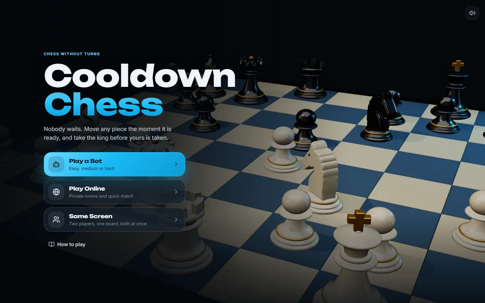
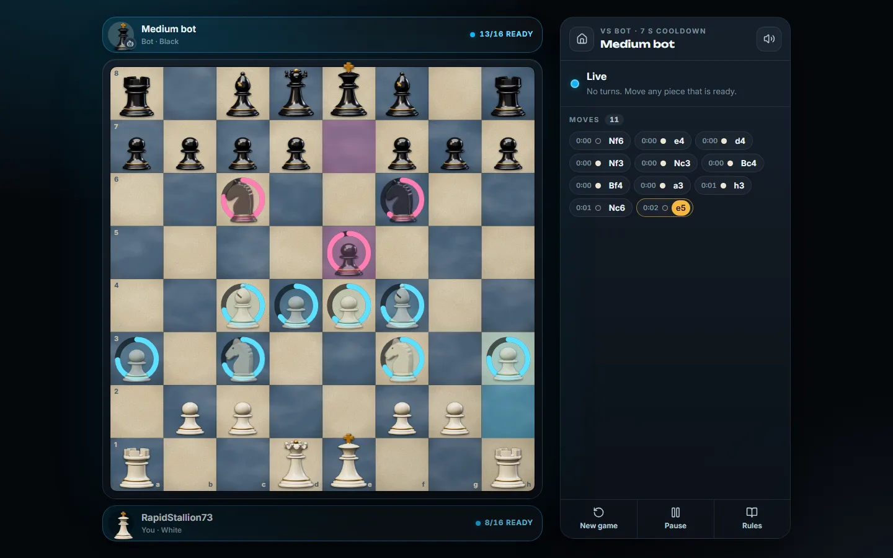
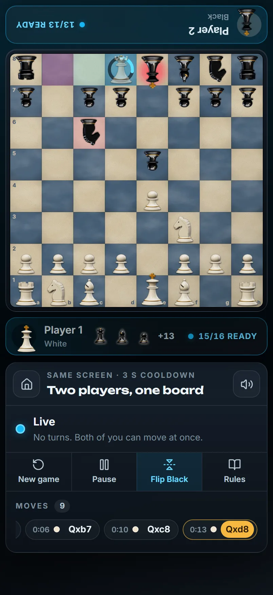
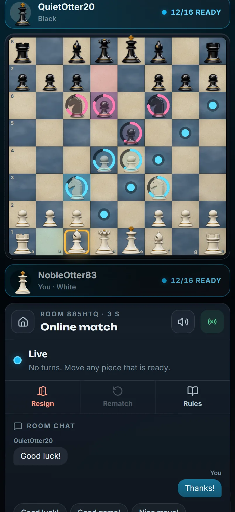

# Cooldown Chess

Real-time chess with no turns. Either player may move any of their pieces at any moment; a piece that has just moved goes on a cooldown before it can move again; and there is no check or checkmate, so you win by actually capturing the king. Play a bot, share one screen with a friend (both of you tapping at once), or play online.

**Status:** complete, deployed and playable. Built in one unattended overnight session; it has never been played by real people, on a real phone or over a real network (see [Verification](#verification)).

**Play it:** https://cooldown-chess.vercel.app

The free game server sleeps when nobody is playing, so the first online connection can take up to a minute. Bot and same-screen games need no server.

## Screenshots

Captured by `scripts/tour-screenshots.mjs` at desktop (1440×900) and phone (402×874) sizes.

| | |
|---|---|
|  |  |
|  |  |

## The rules

The idea is not ours. Real-time chess with per-piece cooldowns was designed and built as a physical electronic board by Xander Naumenko (YouTube channel From Scratch). Each rule below is labelled with where it comes from.

Sources:
- Video: ["I Made Chess Without Turns"](https://www.youtube.com/watch?v=y7VtSK23_Jg) (earlier titled "I Made Chess 2.0"), chapter "Rules of real time chess"
- Firmware: [github.com/misprit7/real-time-chess](https://github.com/misprit7/real-time-chess), `firmware/src/main.cpp`
- The creator's comments on [Hacker News](https://news.ycombinator.com/item?id=43514695)

### Rules from the creator

| Rule | Certainty |
|---|---|
| No turns: either player may move any ready piece at any moment. | Creator's video |
| After a piece moves it is on cooldown and cannot move again until the cooldown ends. Other pieces are unaffected. | Creator's video |
| A piece on cooldown can still be captured. | Creator's video |
| There is no check or checkmate. A player loses when their king is captured. | Creator's video |
| One cooldown length for every piece type. This app offers 3 s, 5 s, 7 s and 12 s, default 5 s. | Creator's video (his spoken example is 5 seconds) and firmware (it offers 3, 7 and 12 with 7 as its default) |

### This app's interpretation

The creator's board does not check whether a move is legal (his own rule is "only one hand and one piece at a time"), and he says nothing about castling, en passant, promotion, simultaneous moves or draws. An app has to decide. Every decision below is a named constant in [`src/variant/interpretation.ts`](src/variant/interpretation.ts).

| Decision | Certainty |
|---|---|
| Pieces move as in chess and the app enforces it, with no check rules at all: a king may move into or stay in attack, and pins do not exist. | This app's interpretation |
| Castling is allowed when the king and that rook have never moved and the squares between them are empty, with no attack conditions. Both the king and the rook go on cooldown. | This app's interpretation |
| En passant is allowed only while the pawn that just double-stepped is still on the cooldown from that double step. | This app's interpretation |
| Promotion is automatic, to a queen (a picker would stop a game that never stops). | This app's interpretation |
| A promoted piece and a capturing piece go on cooldown like any other piece that moved. | This app's interpretation |
| Conflicts: inputs are applied strictly in the order they arrive. A move that is no longer legal when it arrives (its piece was captured, the square changed, the piece is still cooling) is rejected with no penalty. | This app's interpretation |
| No premoves. A cooling piece can be selected to line a move up, but the move is only played once the piece is ready. | This app's interpretation |
| Draws: only when both sides are down to a bare king. No stalemate, repetition or fifty-move rule, and no draw offer in this version. | This app's interpretation |
| Start: a 3-2-1 countdown, then both sides are live at the same instant. There is no side to move; the first-move advantage belongs to whoever is faster. | This app's interpretation |
| Online disconnect: the game clock pauses and every cooldown freezes while a seated player is disconnected, for up to 30 seconds; then that player forfeits. | This app's interpretation |

Not a rule at all: with no check, the app pulses your king's square red (and plays an alert) when an enemy piece that attacks it is ready or will be within 1.5 seconds. Nothing forces you to react.

## Modes

- **Play a Bot**: Easy, Medium or Hard, as White or Black. The bot is a real-time agent with a reaction delay and a minimum gap between its moves; both shrink with difficulty.
- **Same Screen**: two people at one device, White at the bottom and Black at the top, each with their own selection, both able to tap at the same time. An option turns Black's pieces to face a player sitting opposite.
- **Play Online**: private rooms with a six-character code, or quick match, which only pairs players who chose the same cooldown. Side choice, reconnect, rematch, and chat limited to fixed phrases. Players get generated names; nobody can type text another player sees.

Every game can pause in bot and same-screen modes (the Pause button, opening a dialog, or hiding the tab freezes every cooldown).

## How it works

- **One engine, time passed in.** [`src/game.ts`](src/game.ts) is pure TypeScript with no clock of its own. Each piece carries `readyAt`, a time on the game clock, and `getMoves(state, player, now)` and `tryMove(state, player, moveId, now)` take the time as an argument, so the client, the bot and the server compute the same answer and tests need no waiting.
- **A game clock that can stop.** Cooldowns are measured on a game clock ([`src/variant/clock.ts`](src/variant/clock.ts)), not on wall time. The clock starts at −3 s (the countdown) and both sides are live at 0. Pausing stops it, so no `readyAt` ever has to be rewritten: every piece simply becomes ready later in the real world by exactly the length of the pause.
- **The server is the authority.** Clients send move intents (`"e2e4"`). The server handles them one at a time in arrival order, stamps each with its own reading of the room's game clock, asks the engine, and either applies the move and broadcasts the new state or refuses it with the reason (`cooling` with the milliseconds left, `no-piece`, `illegal`, `paused`, ...). Nothing a client says about time is trusted. A per-socket token bucket (24 moves burst, 12 per second) stops floods without touching normal play.
- **Clock sync.** Every snapshot carries the game clock's value and the server's wall time. The client measures the offset between the server's wall clock and its own with small ping/pong requests, trusts the quickest of the last few round trips, and derives the game clock from that. If a move is refused as "cooling" with less than 250 ms left, the two clocks merely disagreed, and the client resends it once.
- **Cooldown rings are CSS.** Each ring is one SVG circle whose dash offset is animated by the browser for the length of the cooldown, started part-way with a negative delay. JavaScript wakes only when the picture has to change (a piece becomes ready, a countdown second passes), with a single timeout for the next such moment.
- **The bot** ([`src/bot.ts`](src/bot.ts)) scores the position after each move it could play right now. Its evaluation understands cooldowns: a piece is lost when an enemy attacker will be ready before the piece can move away, and a king in that state outweighs everything. One decision takes well under a millisecond and runs a few times a second on the main thread.

More detail: [`docs/ARCHITECTURE.md`](docs/ARCHITECTURE.md).

## Run locally

```bash
npm ci
npm run dev:multiplayer   # web app on http://127.0.0.1:4374 and game server on :4375
npm test                  # engine, clock, bot and server tests
npm run build             # type-check and production build
```

`npm run dev:local` runs only the web app (bot and same-screen games do not need the server). The server's health check is `GET /health`.

## Verification

**Automated (`npm test`, 61 tests, no real waiting: every clock is passed in or controlled):**
- `tests/game.test.ts`: no turns; a move before, exactly at and after `readyAt`; each cooldown length; capturing a cooling piece; a captured piece's queued move rejected; two moves for the same square resolved in arrival order; no check; king capture ending the game and later moves rejected; castling and its two cooldowns; the en passant window opening and closing; automatic promotion; the bare-kings draw; notation; and pause and resume moving every ready time by exactly the pause.
- `tests/bot.test.ts`: takes a capturable king at every level; rescues an attacked king; knows when a cooling attacker becomes a threat; grabs free material; avoids squares a ready enemy piece attacks; respects its reaction time and minimum gap; decides in under a millisecond on average; and on a simulated clock Hard beats Easy in at least five of six games without losing any, and Medium beats Easy more often than not.
- `tests/multiplayer.test.ts`: a real Socket.IO server with real clients and a controlled server clock: the countdown, concurrent moves from both players, rejection for cooldown with the time left, conflicting moves resolved in arrival order, king capture and later moves rejected, disconnect freezing every cooldown and resync on reconnect, forfeit after the grace period, rematch resetting board and clock, the move rate limit, clock sync, quick match pairing only equal cooldowns, names, chat and side choice.
- `tests/names.test.ts`, `tests/nativeSafety.test.ts`: generated names and the client-side free-text filter.

**Scripted browser checks (Playwright with Chromium, against `npm run dev:multiplayer`), at desktop and phone sizes:**
- `node scripts/e2e-bots.mjs` (110 checks): a game against the Hard bot played until a king is captured, with the ring, the "still cooling" notice and pause/resume timing; a same-screen game where both sides move within the same second, two simultaneous touch points (emulated, phone size), castling and a king capture; a two-browser online game where both browsers move at the same instant, a move is refused for cooldown, one player disconnects and returns to a frozen game, and a king is captured, followed by a rematch; then quick match by cooldown, names and side choice.
- `node scripts/tour-screenshots.mjs http://localhost:4374 <dir>` walks every screen at both sizes and fails on any console error. The resulting screenshots were looked at, including boards with a dozen rings.

**Never tested:**
- real phones, and multi-touch on real hardware (two fingers were only emulated in desktop Chromium)
- dragging a piece on a touch screen
- the native iOS and Android builds
- the sounds, by ear
- play over a slow or lossy connection, or against the deployed server at all
- balance and bot difficulty with real players; whether 5 seconds is the right default
- browsers other than Chromium

## Known limitations

- The free game server adds latency and sleeps when idle. Online moves are not applied optimistically: a piece moves when the server's answer arrives.
- No lag compensation: the player with the faster connection wins a race for the same square.
- On a shared screen the app cannot tell whose finger touched a square. If a square is a target for both players' selected pieces, the more recent selection wins.
- The bot looks one move ahead. It is quick and it punishes loose pieces and exposed kings, but it does not plan.
- No draw offer, no premoves, no spectators, no ratings.
- The mobile shell's bundle ID is a placeholder (`com.example.cooldownchess`).

## Story

This is the fourth Foundry game built on the Knight Checkers shell (board kit, room server, 3D-rendered pieces, mobile shell). It was made overnight on 2026-11-19/20, inspired by the From Scratch video about a physical chess board with no turns.

## AI assistance and Zach's role

Zach Shirley chose the idea and commissioned the game. Claude (Anthropic's AI model) researched the rules, made the interpretations listed above, and wrote the code, the tests and the art pipeline changes in an unattended session, then ran the checks described under Verification. No human has reviewed the code or played the game yet.

## Attribution

- **Concept:** Xander Naumenko / From Scratch: ["I Made Chess Without Turns"](https://www.youtube.com/watch?v=y7VtSK23_Jg) and [misprit7/real-time-chess](https://github.com/misprit7/real-time-chess). His repository is MIT-licensed; no code or assets from it are used here. This app is an independent tribute and is not affiliated with him.
- **Fonts:** Unbounded and Inter, both under the SIL Open Font License.
- **Icons:** Lucide, ISC License.
- **Pieces, board and home scene:** rendered for this project from its own 3D models ([`art/`](art/README.md)).

## License

No license has been chosen yet. **All rights reserved; the source is public to read.**
